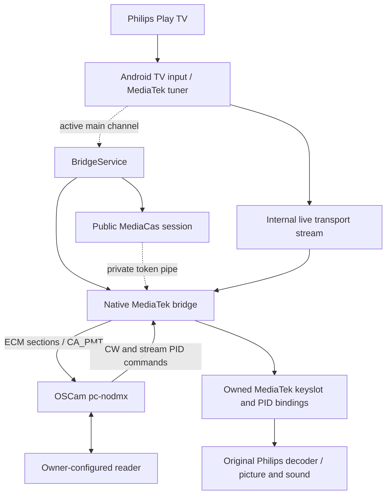

# Philips OLED909 OSCAM with internal DVB-S Philips Tuner

English setup and engineering notes for a TV-specific integration of OSCam with the **original Philips Play TV application and internal tuner**. This repository contains the bridge source, service scripts, pinned OSCam patch, configuration templates and the procedure used on the owner's TV.

**Verified on 24 October 2026:** encrypted Prima HD played with picture and sound; automatic channel changes, service startup after a TV reboot, and OSCam 2.26.09-11968 were tested. The owner confirmed picture and sound after the final upgrade. The remaining CAS stability issue is described below and in [troubleshooting](docs/troubleshooting.md).

## Tested TV and firmware

| Item | Observed value |
| --- | --- |
| Model | **Philips 65OLED909/12** |
| Philips firmware | **TPM231WW_R.201.100.146.220** |
| Firmware property | `ro.odm.tpvision.product.swver` |
| Android | **14** |
| Build display / incremental | `UKN2.241117.001` / `3000428` |
| Android security patch | `2025-09-05` |
| Product device | `PH1M_WW_9972` |
| Kernel | `5.15.180-android14-11-00042-g766efc243647-dirty` |
| Root | **Magisk 31.0**, UID 0, `u:r:magisk:s0` |
| SELinux | **Enforcing** throughout the successful tests |
| OSCam | **2.26.09-11968@39e78a46**, static ARM64 Linux/musl build |

The firmware values were read from the TV, rather than inferred from the product name. Full system/vendor fingerprints are recorded in [tested-firmware.json](docs/tested-firmware.json). The Android security patch date is a separate field from the Philips firmware version.

## Read this first

The working procedure starts with a TV that **already has full Magisk root and an authorized ADB connection**. Root acquisition and bootloader changes were not reproduced as part of this OSCam work. This repository documents the exact root state required and the steps performed after it was available.

The implementation is tied to the tested MediaTek firmware, its CAS plugin and vendor DVB ABI. It uses `demux20`, `ca2`, source 0 and CSA2 for the main live DVB session. PIP, simultaneous recording, other CAS algorithms and other firmware releases have not been validated. It requires the owner's separately configured reader/entitlement source; no reader credentials, control words, firmware dumps or proprietary CAS libraries are included.

Repeated service restarts once led to `IllegalStateException` while opening CAS sessions and a subsequent TV restart. The cause remains unresolved. Normal playback and the recorded tests succeeded; this is still an **experimental integration**, with no claim of production-grade long-term stability.

## Procedure

1. [Confirm firmware, root and host prerequisites](docs/prerequisites.md).
2. [Build the bridge and pinned OSCam source](docs/build.md).
3. [Prepare private configuration and install on the TV](docs/install.md).
4. [Operate the service, use WebIf, upgrade and restore a backup](docs/operations.md).
5. [Validate picture/sound and diagnose failures](docs/troubleshooting.md).

For the reasoning and investigation history, read [architecture and findings](docs/architecture.md) and [the test record](docs/validation.md).

## How it fits together



OSCam's standard Linux CA ioctls cannot be forwarded directly to this TV. The native bridge translates the wire protocol into the verified MediaTek interfaces and owns its own filters and CAS resources. See [architecture](docs/architecture.md).

## Repository contents

| Path | Purpose |
| --- | --- |
| `src/mtk_bridge.c` | Native demux, PMT/PAT checks, DVBAPI connection and vendor CA operations |
| `src/protocol.c` | PMT/CA_PMT and network-frame validation |
| `src/casprobe/BridgeService.java` | Main-channel monitor and MediaCas lifetime management |
| `src/dmx2.h`, `src/dsc_mtk.h` | Public vendor UAPI headers, original notices retained |
| `service/` | Watchdog, control command and Magisk startup hook |
| `tools/` | Compiler wrapper, build commands, checks and firmware capture |
| `patches/` | Android socket path and DVBAPI v1 compatibility patch for OSCam r11968 |
| `examples/` | Placeholder-only configuration templates |
| `docs/` | Complete English procedure, firmware snapshot and validation notes |

## Quick host build

The recorded build host was Apple Silicon macOS with Clang, Python 3, Git, a JDK, Android SDK platform 34 / build-tools 36.1.0, and Zig 0.15.2. The scripts support explicit SDK/JDK/Zig paths; other hosts require independent verification.

```sh
sh tools/bootstrap-zig.sh
export ANDROID_SDK_ROOT="$HOME/Library/Android/sdk"
export JAVAC=/opt/homebrew/opt/openjdk/bin/javac
sh tools/build-bridge.sh
sh tools/build-oscam.sh
```

Build outputs are ignored by Git. The OSCam script fetches official tag `11968` and verifies commit `39e78a4688b30abaab62b5c9e13672b4e34bfca0`. A new build can have a different binary checksum because build timestamps and debug paths are embedded. The deployed binary's recorded checksum is an audit reference, rather than a promise of byte-identical output.

## Configuration and access

Use [the example files](examples/oscam.conf.example) to create configuration **outside this checkout**. Replace every placeholder and adjust the LAN allowlist before installation. Existing installations should retain their current configuration. Credentials are stored on the TV under a root-only directory and are never part of this repository.

WebIf uses `http://TV_IP:8888/`, the configured account, internal jQuery and the configured LAN allowlist. It is an HTTP build without TLS. The service starts after boot and waits for the original TV application's main DVB session; it does not force Play TV to open.

## License and provenance

Project code is licensed under [GPL-3.0-or-later](LICENSE), with separate notices for the public UAPI headers. OSCam is fetched from its official repository and retains its own GPL license. See [THIRD_PARTY_NOTICES.md](THIRD_PARTY_NOTICES.md). No firmware binaries, account secrets or raw diagnostic captures are distributed here.
